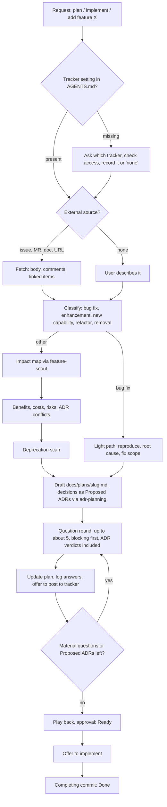

# Plan: feature planning (`feature-planning`)

**Status.** Ready (approved 2026-11-09). Decisions: [ADR 0021](../adr/0021-feature-planning-owns-feature-planning.md).

## Problem

Features get built from a one-line request or half an issue. The agent fills the gaps with guesses, misses what the change breaks or makes obsolete, and asks nothing until the code is written. The fix is a flow that runs before implementation: get the whole description, map what the change does to the project, then ask and refine the plan in rounds until nothing material is open.

## Flow



## Components

| Component | Kind | Role |
| --- | --- | --- |
| `feature-planning` | skill | The flow above. Writes `docs/plans/<slug>.md` and refines it each round |
| `references/sources.md` | skill reference | Works with any tracker: how to reach it (a CLI such as `gh` or `glab`, a tracker MCP tool, a URL, a file in the repo), check access (`gh auth status`, `glab auth status`, a test call to the MCP tool), fetch the full item with its comments and linked items, and post a comment where the tracker allows it. Fetch failure → ask the user to paste; never fill gaps |
| `references/impact-checklist.md` | skill reference | What the impact map and deprecation scan cover. Shared with the subagent ([ADR 0005](../adr/0005-rubrics-live-in-skills.md)) |
| `references/questions.md` | skill reference | Question catalog per topic and the rules for a round, like [`project-init`'s dialogue](../../skills/project-init/references/dialogue.md) |
| `references/plan-template.md` | skill reference | Plan sections (below) |
| `feature-scout` | agent (Claude Code) | Read-only, fresh context, thin wrapper: reads the checklist it is given, maps the impact and the deprecation candidates, returns a short report. No `model` in its frontmatter: the skill passes the recorded scout model when it delegates |

### Settings in `AGENTS.md`

The skill keeps two settings in a short section of the project's `AGENTS.md`, which every harness loads. It creates `AGENTS.md` only when the project has neither `AGENTS.md` nor `CLAUDE.md`, and otherwise writes to `CLAUDE.md`, the same rule `adr-planning` follows:

```markdown
## Feature planning

- Tracker: GitHub issues, via `gh`    <!-- or: none -->
- Scout model: sonnet
```

- **Tracker missing** → ask which tracker the team uses. Check that the agent can reach it; if it can't, walk the user through logging in (`gh auth login`, `glab auth login`, connecting an MCP server). Then record it. The skill never creates a tracker or a project. With no tracker, record `none`: from then on the skill doesn't ask, intake uses the user's description, and nothing is posted.
- **Scout model missing** → ask the first time the skill delegates, and record the answer. In Claude Code the skill passes it to `feature-scout`. Other harnesses use their own small read-only scout agent if they have one, with the checklist passed to it; without one, the skill does the analysis inline.
- Settings that are there are never asked again; the user edits the section to change them.

### Plan sections

Status (Draft / Ready / Done) · Source (links, date fetched) · Summary in the user's words · Type · Benefits and who gets them · Impact map (modules, entry points, public API/CLI/config, data and migrations, docs, tests, performance, security) · Deprecations (what becomes obsolete, the callers to migrate, the user's choice per finding: remove or deprecate) · Risks and quirks · Decisions (with ADR links) · Assumptions (not verified, to confirm) · Open questions (blocking / non-blocking) · Acceptance criteria · Implementation steps · Refinement log (round, question, answer).

### Skill procedure

1. **Intake.** Read the settings, asking for and recording any that are missing. Ask whether there is an external description (an issue, MR, ticket, doc, or URL) and fetch all of it, comments and linked items included. No source → ask the user to describe the feature in their own words.
2. **Classify** the change. Bug fixes take the light path below.
3. **Understand the project**: `PROJECT.md`, `AGENTS.md`, the Accepted ADRs, then the code the feature touches. Delegate the impact map to `feature-scout`, or to the harness's scout.
4. **Benefits, costs, risks.** Conflicts with Accepted ADRs come up here, never silently deviated from.
5. **Deprecation scan** for new functionality: code, config, and docs that overlap or are replaced, and the callers that have to move.
6. **Draft the plan.** Everything unknown goes to *Open questions*, everything inferred to *Assumptions*.
7. **Refine in rounds.** Up to about five related questions per round, blocking ones first; each issue or quirk comes with options and a recommendation. Each deprecation finding is its own question: remove it in this feature, or deprecate it first. After each round: update the plan, log the answers, and check the impact again if the scope changed. With a tracker source, offer to post the round's open questions as a comment (ask every time). Stop when no material question remains, or when the user says enough; whatever is left stays open and marked.
8. **Ready.** Play the plan back in a few lines and ask for approval; on approval the status becomes *Ready*. Architectural choices went to `adr-planning` while drafting (Proposed ADRs, briefed in the rounds); none may still be Proposed at *Ready*. Nothing is implemented before *Ready*: a rule in the skill, not a hook or gate. Then offer to implement following the plan's steps; "go ahead" starts it in the same session.
9. **Done.** The commit that completes the feature sets the status to *Done*. The file stays, as history next to the ADRs.

**Trigger.** Requests to plan, implement, or add a feature ("plan X", "implement issue #42", "add X"), and bug reports from an issue or with an unknown cause. A size gate skips the skill for small, fully specified changes: one place in the code, the behavior stated, no issue or document to read (a typo, a rename, "add a --verbose flag to cli.py that prints each step"), and for a plain failing test with a clear cause. Those go straight to the change.

**Bug fixes** that pass the gate take a light path: full intake (the issue and its comments), then reproduce → root cause → fix scope → acceptance. Benefits and the deprecation scan are skipped unless the fix changes behavior.

## Overlaps in this repo (deprecation scan)

| Finding | Overlap | Recommendation |
| --- | --- | --- |
| [Roadmap](roadmap.md) phase 5 `plan.md` prompt ("Feature plan … templates referencing ADRs") | Replaced by `references/plan-template.md` in the skill (ADR 0005: what a skill uses lives in the skill) | Removed from the roadmap; `feature-planning` added to phase 2 |
| Roadmap phase 3 `scout` (a general read-only code mapper) | `feature-scout` covers feature impact only | Kept as a separate item; `feature-scout` added to phase 3 with the follow-up: it can become a checklist passed to `scout` once that exists |
| `adr-planning`'s trigger "planning or defining a new feature" | Fires on the same requests as `feature-planning` | Narrow it to decisions (already decided in round 1, through the ADR) |

## Repo work

- **ADR 0021**: `feature-planning` owns planning and defining features and hands architectural decisions to `adr-planning`; plans live in committed `docs/plans/<slug>.md`; the project's settings live in a section of `AGENTS.md`.
- **`adr-planning`**: narrow its description to the decisions. Its planning evals (`plan-feature`, `contradiction`, `existing-format`) now load `feature-planning` first, which would stop at the tracker or source question in a single-prompt run; their scaffolds get a `## Feature planning` section (`Tracker: none`), and their prompts say there is no issue or spec. `feature-planning` hands decisions over while drafting (Proposed ADRs, briefed in the next round), so those evals still see the ADRs. Its `bug-fix` eval (a plain failing test) and `project-init`'s `feature-request` (a small, fully specified flag) are below the size gate and stay as they are.
- **Files**: `skills/feature-planning/` (SKILL.md + 4 references), `agents/feature-scout.md`, `catalog.tsv` rows (the skill requires `adr-planning`, which records its decisions; the agent requires `feature-planning`), `.claude-plugin/plugin.json` (agent), README components table, `evals/README.md`, CHANGELOG `[Unreleased]`, roadmap.
- **Evals** in `evals/feature-planning/`:

  | Case | Checks |
  | --- | --- |
  | `asks-for-source-first` | Bare "plan feature X" with a tracker recorded: the first question asks for an external description |
  | `tracker-setup` | No settings section; the user says there is no tracker: `AGENTS.md` records `Tracker: none`; no other tracker question |
  | `external-issue` | A fake `gh` on `PATH` returns an issue with comments: the plan cites the body and the comments and invents nothing |
  | `implement-request` | "Implement issue #7": plan and questions before any code edit |
  | `vague-request` | Asks the blocking questions first, writes no code, the plan has *Open questions* |
  | `deprecation` | A seeded old code path that the feature replaces: the plan lists it with its callers and asks remove or deprecate |
  | `adr-conflict` | The request contradicts an Accepted ADR: the conflict is raised and handed to `adr-planning` |
  | `refine-round` | A scaffolded plan with open questions, and a prompt that answers them: the plan is updated in place, the log grows, the answered items leave *Open questions* |
  | `bug-fix` | A bug issue: light path (reproduction, root cause), no benefits or deprecation filler |
  | `small-change` (negative) | "Add a --verbose flag to cli.py that prints each step" goes straight to the change: no plan, no question first. The skill may load (Claude Code matched its description in the 2026-11-09 run) but its size gate skips it |

  `refine-round` simulates the second turn with a scaffold, because an eval case is a single prompt: the run ends at the agent's first question.
- **Validation**: `tests/run.sh`, `afk --check --source .`, `claude plugin validate .`, and an eval run of `feature-planning` and `adr-planning` (`--tag`).
- **Release**: minor bump, done at the next release, not in this change.

## Acceptance

- Every eval case above passes with the plugin; `adr-planning`'s cases still pass.
- A real run in this repo on a GitHub issue: settings recorded, issue and comments fetched, at least one question round, plan *Ready*, ADRs handed off.
- `tests/run.sh` is green (catalog rows, plugin manifest).

## Open questions

None.

## Refinement log

| Round | Question | Answer |
| --- | --- | --- |
| 1 | Relation to `adr-planning` | Orchestrate: `feature-planning` owns feature planning and hands off decisions |
| 1 | Sources fetched directly | No answer (nothing selected); asked again in round 2 |
| 1 | Write-back to tracker | Offer to post each round, ask first |
| 1 | Plan location | `docs/plans/<slug>.md`, committed |
| 1 | Bug fixes | Light path in the same skill |
| 1 | Question pacing | Batches of about five, blocking first, plan updated every round |
| 1 | Enforcement | Rule in the skill only |
| 1 | Subagent | Dedicated read-only `feature-scout` |
| 1 | Deprecation default | Asked per finding |
| 1 | Name | `feature-planning` |
| 2 | Sources | Any tracker. None recorded → ask the user to set one up; with no tracker, record that and stop asking |
| 2 | Trigger | Plan and implement requests; trivial changes excluded |
| 2 | After Ready | Offer to implement; "go ahead" starts it |
| 2 | Plan lifecycle | Kept, status *Done* |
| 2 | Scout model | The user's choice; other harnesses use a small scout agent where they have one |
| 3 | Where settings are kept | A "Feature planning" section in `AGENTS.md` |
| 3 | Tracker setup | Access only: check it, help log in, record it; never create a tracker |
| 3 | Scout model when none is recorded | Ask once and record it |
| 4 | Roadmap `plan.md` prompt | Removed; roadmap lists `feature-planning` instead |
| 4 | Roadmap `scout` | Kept separate; follow-up noted at `feature-scout` |
| 4 | Small, fully specified tasks (found while implementing) | Size gate: skip the skill; a plain failing test is just fixed; existing evals stay valid |
| 5 | When decisions go to `adr-planning` (found while implementing) | While drafting, as Proposed ADRs briefed in the next round; Ready needs none left Proposed. Matches `adr-planning`'s own procedure and keeps its planning evals working |
| 6 | When an ADR is written (found in the eval run) | When its choice is made or clear: at once, briefed in the first round. When it depends on a blocking question: after the answer. The agent did this on its own in the runs, and it matches the incremental refinement asked for |
