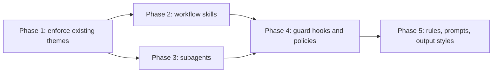

# Plan: component roadmap

New components, ordered by how much they strengthen the repo's existing themes (decisions recorded, review at the commit boundary, docs kept true). Every component follows the repo conventions: one self-contained file or folder, an eval under `evals/`, and an ADR when it makes a structural choice.

Phase 1 comes first because it turns rules the model must remember into deterministic behavior. Phases 2 and 3 are independent. Phase 4 builds on the hook infrastructure and CI from the [design plan](design-improvements.md) and on the installer's `hook` kind from phase 1. Phase 5 is packaging.

## Phase 1: enforce existing themes

**Starting point.** Components are installed by the `agentic-toolkit` binary, which embeds them ([ADR 0009](../adr/0009-installer-in-rust.md), [ADR 0010](../adr/0010-components-embedded-in-binary.md)), records each install in the manifest ([ADR 0008](../adr/0008-project-install-manifest.md)), and reads `catalog.tsv` ([ADR 0007](../adr/0007-component-catalog.md)). The engine installs the `skill` and `agent` kinds only. `commit-gate` is a Claude Code `PreToolUse` hook that ships with the plugin; its catalog row says `plugin`, and installing it in a project is deferred to this phase ([selective install S5](selective-install.md#s5-commit-gate-outside-the-plugin)). Its review and docs stamps live in `.git/`, so any gate that git runs can read them.

| Component | Type | What it does | ADR |
| --- | --- | --- | --- |
| Portable commit gate | git `pre-commit` hook | Same review/docs checks as `commit-gate.sh`, run by git, so the gate works in every harness (all agents run git). Reads the same `.git/` stamps and `.commit-gate-docs`. Denial text on stderr reaches the agent and tells it to ask the user; `--no-verify` keeps its git meaning. Git runs it only for commits, so it needs no `parse-commit.py`: bash and git only (Git for Windows ships bash). Fails open | new — supersedes ADR 0002's "Claude Code only" consequence |
| `hook` kind | installer | `agentic-toolkit commit-gate` installs the git hook into the project, records it in the manifest, and `--update`, `--remove`, `--list`, and the UI treat it like any other kind. The catalog row's `harnesses` becomes `all`. Never overwrites an existing `pre-commit` hook (husky, pre-commit framework, hand-written); it reports and stops, or chains when the user agrees. Closes S5 | new — where the hook lives and how it coexists with other hooks |
| Gate names what is installed | gate | The denial message and stamp command name the skills as installed: `/agentic-toolkit:code-review` with the plugin, `code-review` in a project install. The stamp command works without the plugin path (for example the installed hook run with `--stamp-review`); `code-review` and `doc-sync` follow whatever the message says | — |
| One gate at a time | gate | With the plugin and the git hook both present, the user is asked once: the plugin's `PreToolUse` gate allows when the git hook is installed | — |
| `adr-guard` | check in the git hook; optional `PreToolUse` (Edit/Write) in the plugin | Denies a commit that changes an `Accepted` ADR anywhere except its Status line (`Superseded by …`). The git check works in every harness; the plugin hook gives earlier feedback in Claude Code | new — turns a skill rule into enforcement |
| `adr-index` | SessionStart hook (plugin) | Injects Accepted ADR titles and paths (one line each) into context so every session knows the decisions exist. Other harnesses rely on `AGENTS.md` pointing at `docs/adr/` ([`project-init`](../../skills/project-init/SKILL.md) writes it) | — |
| `ship` | skill (explicit invocation) | Code review → doc sync → commit message → commit, in one explicit flow; reuses existing skills and stamps as it goes, so the gate passes. A skill, not a command, so it works in every harness ([ADR 0005](../adr/0005-rubrics-live-in-skills.md)) | — |
| `adr` (create, supersede) | extend `adr-planning` | `adr-planning` already records accept and reject verdicts. Add creating an ADR on demand and superseding one with both records updated, instead of a second ADR skill | — |

**Plan.** [Phase 1 plan](phase1-enforce-themes.md). The decisions below are recorded as ADRs [0013](../adr/0013-commit-gate-as-git-hook.md), [0014](../adr/0014-git-hook-layout.md), and [0015](../adr/0015-accepted-adrs-guarded-at-commit.md), all Accepted (2026-10-30).

**Decisions before implementation** (through [adr-planning](../../skills/adr-planning/SKILL.md); the next free number is 0013):

- Where the installed hook lives. `.git/hooks/pre-commit` is per clone and not committed, so every clone runs `agentic-toolkit --update`. A committed `.agents/hooks/pre-commit` with `core.hooksPath` is shared but still needs per-clone config and replaces the repository's other hooks.
- How the manifest records a file outside the working tree (`.git/hooks/`), and what `--check` and the UI show when a clone lacks it.
- How the plugin gate detects the git hook (a marker line in the hook, or the manifest row).

**Order.** ADRs → portable gate script (shares its checks with `commit-gate.sh` rather than copying them) → `hook` kind in the engine, status, manifest, and UI → gate messages and one-gate rule → `adr-guard` → `adr-index` → `ship` and the `adr-planning` extension.

**Every component** has a `catalog.tsv` row (`tests/catalog.test.sh` fails without one), plugin wiring in `hooks/hooks.json` where it is a Claude Code hook, and updates to the README, `hooks/README.md`, and the CHANGELOG. Hooks and checks get deterministic tests in `tests/` (fail open on unexpected input, silent on success). Skills get eval cases under `evals/`: a golden task and a negative case.

**Acceptance.**

- Gate fires from Codex/Cursor/OpenCode commits (manual check per harness) and from a plain `git commit` in a terminal; a skill stamp unblocks it; `--no-verify` bypasses it.
- `agentic-toolkit commit-gate` installs the hook in a project, `--update` restores a deleted hook, `--remove` removes it, an existing `pre-commit` hook is never overwritten, and `--list` no longer shows `commit-gate` as plugin-only. Covered by installer tests on Linux, macOS, and Windows CI.
- With the plugin and the git hook both installed, one unreviewed commit asks once.
- Committing an edit to an Accepted ADR is denied; changing only its Status to `Superseded by NNNN` is allowed.
- A new Claude Code session can list Accepted ADRs without reading `docs/adr/`.
- `ship` and the `adr-planning` extension pass `agentic-toolkit --check --source .` and their evals.

## Phase 2: workflow skills

| Skill | Trigger ("use when …") | Core procedure |
| --- | --- | --- |
| `handoff` | Ending a session with unfinished work | Write `docs/handoff/<date>.md`: state, next steps, open decisions, linked ADRs |
| `systematic-debugging` | A bug or failing test with unknown cause | Reproduce → isolate → prove root cause → fix → regression test |
| `test-first` | Implementing behavior with a clear spec | Failing test first, minimal implementation, refactor |
| `commit-message` | Composing a commit | Conventional Commits; references the ADR when the change implements one |
| `pr-description` | Opening a PR | Summary, motivation, linked ADRs, test evidence, risk |
| `security-review` | Diff touches auth, input parsing, secrets, deserialization | Threat-model pass over the diff; feeds code-review findings |
| `dependency-upgrade` | Bumping a dependency | Changelog read, breaking-change scan, callers updated, tests run |
| `glossary` | Domain terms are introduced or disputed | Maintain `docs/GLOSSARY.md`; ADRs and docs use its terms |

**Acceptance.** Each skill passes `agentic-toolkit --check --source .` and has a golden task plus a negative case (trigger must not fire on unrelated work).

## Phase 3: subagents

| Agent | Model | Tools | Purpose |
| --- | --- | --- | --- |
| `scout` | fast/cheap | read-only | Map unfamiliar code and return compressed context |
| `test-writer` | strong | read + write tests only | Write the covering test a review flagged as missing |
| `adr-reviewer` | strong | read-only | Check a Proposed ADR for forces, real alternatives, rejection reasons, one-page size |
| `security-reviewer` | strong | read-only | Backs the `security-review` skill with fresh eyes |

**Acceptance.** Each agent states its read/write boundary in frontmatter tools; evals seed a defect the agent must find.

## Phase 4: guard hooks and policies

| Component | Type | What it does |
| --- | --- | --- |
| `secret-scan` | PreToolUse hook (Write/Edit) | Denies writes containing high-confidence secret patterns |
| `format-on-edit` | PostToolUse hook | Runs the project's formatter on edited files when configured; silent otherwise |
| `stop-check` | Stop hook | Warns once when the session ends with uncommitted changes or tests not run after edits |
| `safe-defaults` | policy | Deny `git push --force` to the default branch, `curl … \| sh`, reads of `.env*`, `rm -rf` outside the repo |
| `read-only` | policy | Read/search tools only; preset for review sessions |

Policies first where a declarative deny rule suffices (per `policies/README.md`); hooks only for content checks.

**Acceptance.** Each hook has deterministic tests in `tests/`, fails open on unexpected input, and stays silent on success.

## Phase 5: rules, prompts, output styles

| Component | Type | Contents |
| --- | --- | --- |
| `AGENTS.md` base | rule | Points at `docs/adr/`, the commit-gate workflow, test and docs expectations; how `CLAUDE.md` imports it (`@AGENTS.md`, as [`project-init`](../../skills/project-init/SKILL.md) sets up) and `GEMINI.md` symlinks to it |
| Stack rules | rules | Short per-language conventions (`rules/python.md`, `rules/typescript.md`) |
| `adr.md` | prompt | ADR template extracted from the adr-planning skill (single source; the skill links it) |
| `plan.md`, `pr.md` | prompts | Feature plan and PR templates referencing ADRs |
| `reviewer` | output style | Findings-only, severity-ranked responses |
| `explanatory` | output style | Teaching mode: rationale and tradeoffs alongside changes |

**Acceptance.** Templates contain placeholders, not prose; every prompt used by a skill is referenced from it, not duplicated.
