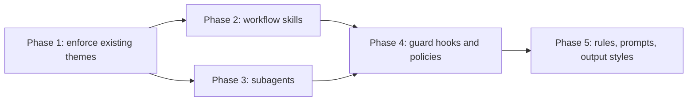

# Plan: component roadmap

New components, ordered by how much they strengthen the repo's existing themes (decisions recorded, review at the commit boundary, docs kept true). Every component follows the repo conventions: one self-contained file or folder, an eval under `evals/`, and an ADR when it makes a structural choice.

Phase 1 comes first because it turns rules the model must remember into deterministic behavior. Phases 2 and 3 are independent. Phase 4 builds on the hook infrastructure and CI from the [design plan](design-improvements.md). Phase 5 is packaging.

## Phase 1: enforce existing themes

| Component | Type | What it does | ADR |
| --- | --- | --- | --- |
| Portable commit gate | git `pre-commit` hook + installer | Same review/docs checks as `commit-gate.sh`, installed as a git hook, so the gate works in every harness (all agents run git); denial text reaches the agent via stderr; `--no-verify` keeps its git meaning | new — supersedes ADR 0002's "Claude Code only" consequence |
| `adr-guard` | PreToolUse hook (Edit/Write) | Denies edits to an ADR whose status is `Accepted`, except the `Superseded by` status line | new — turns a skill rule into enforcement |
| `adr-index` | SessionStart hook | Injects Accepted ADR titles and paths (one line each) into context so every session knows the decisions exist | — |
| `ship` | skill (explicit invocation) | Code review → doc sync → commit message → commit, in one explicit flow; reuses existing skills. A skill, not a command, so it works in every harness ([ADR 0005](../adr/0005-rubrics-live-in-skills.md)) | — |
| `adr` (create, accept, supersede) | skill (explicit invocation) | Create an ADR on demand; accept or supersede one with both records updated. Could extend `adr-planning` instead of adding a skill | — |

**Acceptance.** Gate fires from Codex/Cursor/OpenCode commits (manual check per harness); editing an Accepted ADR is denied; a new session can list Accepted ADRs without reading `docs/adr/`.

## Phase 2: workflow skills

| Skill | Trigger ("use when …") | Core procedure |
| --- | --- | --- |
| `handoff` | Ending a session with unfinished work | Write `docs/handoff/<date>.md`: state, next steps, open decisions, linked ADRs |
| `systematic-debugging` | A bug or failing test with unknown cause | Reproduce → isolate → prove root cause → fix → regression test |
| `test-first` | Implementing behavior with a clear spec | Failing test first, minimal implementation, refactor |
| `commit-message` | Composing a commit | Conventional Commits; references the ADR when the change implements one |
| `pr-description` | Opening a PR | Summary, motivation, linked ADRs, test evidence, risk |
| `security-review` | Diff touches auth, input parsing, secrets, deserialization | Threat-model pass over the diff; feeds code-review findings |
| `dependency-upgrade` | Bumping a dependency | Changelog read, breaking-change scan, callers updated, tests run |
| `glossary` | Domain terms are introduced or disputed | Maintain `docs/GLOSSARY.md`; ADRs and docs use its terms |

**Acceptance.** Each skill passes `./install.sh --check` and has a golden task plus a negative case (trigger must not fire on unrelated work).

## Phase 3: subagents

| Agent | Model | Tools | Purpose |
| --- | --- | --- | --- |
| `scout` | fast/cheap | read-only | Map unfamiliar code and return compressed context |
| `test-writer` | strong | read + write tests only | Write the covering test a review flagged as missing |
| `adr-reviewer` | strong | read-only | Check a Proposed ADR for forces, real alternatives, rejection reasons, one-page size |
| `security-reviewer` | strong | read-only | Backs the `security-review` skill with fresh eyes |

**Acceptance.** Each agent states its read/write boundary in frontmatter tools; evals seed a defect the agent must find.

## Phase 4: guard hooks and policies

| Component | Type | What it does |
| --- | --- | --- |
| `secret-scan` | PreToolUse hook (Write/Edit) | Denies writes containing high-confidence secret patterns |
| `format-on-edit` | PostToolUse hook | Runs the project's formatter on edited files when configured; silent otherwise |
| `stop-check` | Stop hook | Warns once when the session ends with uncommitted changes or tests not run after edits |
| `safe-defaults` | policy | Deny `git push --force` to the default branch, `curl … \| sh`, reads of `.env*`, `rm -rf` outside the repo |
| `read-only` | policy | Read/search tools only; preset for review sessions |

Policies first where a declarative deny rule suffices (per `policies/README.md`); hooks only for content checks.

**Acceptance.** Each hook has deterministic tests in `tests/`, fails open on unexpected input, and stays silent on success.

## Phase 5: rules, prompts, output styles

| Component | Type | Contents |
| --- | --- | --- |
| `AGENTS.md` base | rule | Points at `docs/adr/`, the commit-gate workflow, test and docs expectations; symlink instructions for `CLAUDE.md` / `GEMINI.md` |
| Stack rules | rules | Short per-language conventions (`rules/python.md`, `rules/typescript.md`) |
| `adr.md` | prompt | ADR template extracted from the adr-planning skill (single source; the skill links it) |
| `plan.md`, `pr.md` | prompts | Feature plan and PR templates referencing ADRs |
| `reviewer` | output style | Findings-only, severity-ranked responses |
| `explanatory` | output style | Teaching mode: rationale and tradeoffs alongside changes |

**Acceptance.** Templates contain placeholders, not prose; every prompt used by a skill is referenced from it, not duplicated.
