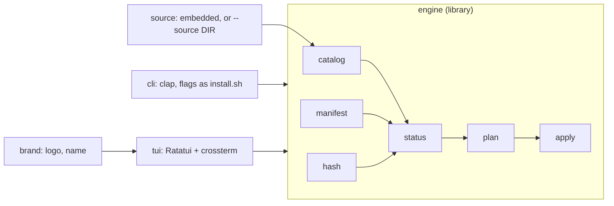

# Plan: Rust installer with a terminal UI, branded Entropy Fox

`install.sh` (see [selective install](selective-install.md)) does the job, but its menu is a numbered `read` loop and Windows needs Git Bash. This plan replaces it with one Rust binary, `agentic-toolkit`, that keeps the same command line, manifest, and safety rules, adds a real terminal UI, and shows the Entropy Fox logo and name.

Decisions, all `Accepted` (2026-10-28):

- [ADR 0009](../adr/0009-installer-in-rust.md): the installer is a Rust binary (Ratatui UI) that replaces `install.sh`, with the same contract.
- [ADR 0010](../adr/0010-components-embedded-in-binary.md): components are built into the binary; `--source DIR` for contributors and tests; releases with dist.
- [ADR 0011](../adr/0011-brand-assets-not-mit.md): the Entropy Fox name and logo live in `assets/brand/`, outside the MIT licence.

Unchanged: [ADR 0006](../adr/0006-project-scope-install-default.md) (project scope, copies), [ADR 0007](../adr/0007-component-catalog.md) (`catalog.tsv`), [ADR 0008](../adr/0008-project-install-manifest.md) (manifest, content hash).

## What the user sees

```
$ curl -LsSf https://github.com/DNRN/agentic-toolkit/releases/latest/download/agentic-toolkit-installer.sh | sh
$ cd ~/code/shop && agentic-toolkit
```

```
 ┌──────────────────────┐
 │                      │   Entropy Fox
 │                      │   agentic-toolkit 0.3.0
 │   fox logo, 24×8     │
 │                      │   Project  ~/code/shop
 │                      │   Plugin   not enabled
 │                      │   Harness  claude, codex, opencode
 └──────────────────────┘
┌ Components ───────────────────────────────────┬ code-review ──────────────────┐
│   component      kind   project   global      │ Fresh-eyes review before      │
│   adr-planning   skill  installed -           │ commit.                       │
│ ▸ code-review    skill  outdated  linked !    │ Needed by code-reviewer.      │
│ + doc-sync       skill  -         -           │ ! also installed globally:    │
│ + code-reviewer  agent  -         n/a         │   Codex lists it twice.       │
│   doc-auditor    agent  -         n/a         │ Writes                        │
│   commit-gate    hook   n/a       n/a         │   .agents/skills/code-review  │
│                                               │   .claude/skills/code-review  │
└───────────────────────────────────────────────┴───────────────────────────────┘
 space mark · u update · g global · enter review · ? help · q quit
```

- The logo is small: 24×8 cells next to the name. Terminals with the Kitty, Sixel, or iTerm2 image protocol show it at full resolution; others get half-block characters on the brand navy `#144b74`, where the dark legs stay visible. Half-blocks below 24 columns lose the head (checked 2026-10-28 at 16, 20, and 24 columns), so on a terminal smaller than 80×24, under `NO_COLOR`, or without truecolor, the logo is hidden and the name stays.
- Enter shows the plan (the same lines as `--dry-run`) in a popup; `y` applies it, anything else goes back. Retired components and orphaned requirements appear in the plan as removals, so confirming the plan is the confirmation ([selective install, updates](selective-install.md#updates)).
- Without a terminal, or with arguments, it is the same command line as `install.sh` today.

## Architecture



- `engine` holds every rule that `install.sh` has today: scopes and refusals, legacy detection, status precedence, the plan for install, update, and remove, `ask-remove` confirmation, path filtering of manifest rows, form (link or copy) per global path. `cli` and `tui` only build requests and render plans.
- `source` is a trait over "the toolkit": `Embedded` (`include_dir!` of `catalog.tsv` and every path it lists, plus the version) and `Directory(PathBuf)` for `--source`.
- Crates: `ratatui`, `crossterm`, `ratatui-image` and `image` (PNG only), `clap`, `sha2`, `include_dir`. No async runtime, no network.
- Layout: a Cargo workspace at the repository root with one crate in `installer/`, so `cargo` and dist work from the root and the component folders stay as they are.

## Compatibility contract

The port is done when these hold; each is checked by a test, not by reading code.

| Contract | Source of truth | Check |
| --- | --- | --- |
| Command-line flags, exit codes, refusals | `install.sh --help`, [selective install](selective-install.md) | `tests/install.test.sh` against the binary |
| `--list` table: columns, status words, notes | `install.sh` output | same suite (`st()` parses it) |
| Plan lines (`copy`, `link`, `update`, `remove`, `keep`, `skip`, `ok`) and the messages tests look for | `install.sh` output | same suite |
| Manifest format, sort order, CRLF tolerance, path filter | [ADR 0008](../adr/0008-project-install-manifest.md) | same suite, plus a Rust test that reads a manifest written by `install.sh` |
| Content hash | ADR 0008: `sha256` over `"<sha256 of file without \r> ./<path>\n"` lines, paths sorted bytewise (`LC_ALL=C sort`), `.agentic-toolkit-install` excluded; a file is `sha256` of its content without `\r`; `-` for a global symlink install | golden test: the Rust hash equals `install.sh`'s hash for every catalog component and for fixtures with CRLF, nested folders, and non-ASCII names |

Interactive behaviour moves from the piped-stdin menu tests to Rust tests on Ratatui's `TestBackend`, which send key events and assert on the rendered buffer and on the requests handed to the engine.

## Order

| # | Item | Depends on | ADR | Status |
| --- | --- | --- | --- | --- |
| R0 | This plan; ADRs 0009–0011 accepted | — | 0009–0011 | done |
| R1 | Workspace, CI, `--check` and `--list` from embedded or `--source` | R0 | 0009, 0010 | done (CI green on Linux, macOS, Windows, 2026-10-28) |
| R2 | Engine port: install, update, remove at parity | R1 | 0009 | done (CI green on Linux, macOS, Windows, 2026-10-28) |
| R3 | Terminal UI | R2 | 0009 | done: `TestBackend` tests, pseudo-terminal run on Linux |
| R4 | Entropy Fox brand | R3 | 0011 | done: half-blocks checked in a pseudo-terminal and a rendered screenshot; Kitty, Sixel, and iTerm2 not yet seen in a real terminal |
| R5 | Releases with dist | R2 | 0010 | open |
| R6 | Cutover: remove `install.sh`, docs, release 0.3.0 | R2–R5 | 0009, 0010 | open |
| R7 | Guides in the UI | R6 | new, if guides need their own format | later |

Before R1: merge PR #1 (done 2026-10-28). The separate bash release (0.2.0) is dropped: there are no users yet, so the first release with selective install is the Rust installer, as 0.2.0.

## R1. Workspace, CI, read-only commands

**Change.**

- Root `Cargo.toml` workspace, crate `installer/`, binary `agentic-toolkit`. `rust-toolchain.toml` pins a stable toolchain.
- `source` with both implementations; catalog parsing (same rules as `tests/catalog.test.sh`); `--check` (the Agent Skills rules `install.sh --check` applies).
- `hash`, with golden tests: fixed expected values computed with `install.sh`'s algorithm (CRLF, nested folders, non-ASCII names, the old marker file), so they run without bash.
- `--list` (read-only status) with the same table.
- CI job `rust` on Linux, macOS, Windows: `cargo fmt --check`, `cargo clippy -- -D warnings`, `cargo test`, `cargo build --release`, then `tests/install.test.sh` against the binary.
- `tests/install.test.sh`: when `AGENTIC_TOOLKIT_BIN` is set, `$C/install.sh` becomes a wrapper that sends `--list` and `--check` to the binary (`--source` the wrapper's folder) and everything else to the real `install.sh`. Every `--list` check then reads state that `install.sh` wrote, which is the compatibility R2 depends on. R2 sends every command to the binary. Every other line of the suite stays.

**Acceptance.** Golden hash tests pass. Every check in `tests/install.test.sh` passes with the binary answering `--list`, on all three platforms, including a fixture component with CRLF content, nested folders, and a non-ASCII file name installed by `install.sh`.

## R2. Engine port

**Change.** Install, `--all`, `--update`, `--remove`, `--project`, `--global`, `--harness`, `--mode`, `--force`, `--dry-run`, `--yes`; legacy installs; the both-scopes warning and prompt; the commit hint. Error messages and plan lines match `install.sh` word for word where the suite checks them.

Global symlinks need a folder to point into, and built-in components (ADR 0010) have none: without `--source`, global installs are copies and `--mode symlink` is refused. A global link that `install.sh` recorded (hash `-`) is restored as a copy when `--update` runs without `--source`. Copies keep files' executable bits, so a skill's scripts stay runnable.

**Acceptance.**

- `tests/install.test.sh` passes against the binary on Linux, macOS, and Windows (Windows runs the suite in Git Bash, the binary natively), except the menu section, which R3 replaces.
- A project installed with `install.sh` 0.2.0 lists as `installed` with the binary built from the same commit, and `--update` changes nothing.
- No `unsafe`; filesystem writes only in `apply`.

## R3. Terminal UI

**Change.** The screen above: header, component table with project and global columns, detail pane (summary, requires, needed by, harnesses, paths it writes, both-scopes warning), marks (`+` install, `-` remove, `~` update), `g` switches scope, Enter opens the plan popup, `y` applies through the engine and shows the result, `?` help, `q` or Esc quits. The terminal is always restored, including on panic.

**Acceptance.**

- `TestBackend` tests cover every case the piped menu tests cover today: mark, review, apply; marking an installed component removes it; quit and decline change nothing; `g` switches scope; the hook explains why it can't be selected; the review lists the requirement that applying removes.
- The menu section of `tests/install.test.sh` is deleted.
- Manual run in an 80×24 terminal, in a larger one, and in Windows Terminal: layout fits, keys work, terminal restored after `q` and after Ctrl-C.

## R4. Entropy Fox brand

**Change.**

- `assets/brand/fox.svg`, copied unmodified from `entropyfox.com` (`site/static/img/fox.svg`); `assets/brand/fox.png`, rendered from it at the size the header needs, on transparent background; `assets/brand/render.sh` regenerates the PNG with `rsvg-convert`; `assets/brand/LICENSE` per ADR 0011. The root `LICENSE` and README state the exception.
- The binary embeds the PNG and the name constant `Entropy Fox`. `ratatui-image` picks Kitty, Sixel, or iTerm2 when the terminal supports one, half-blocks on navy otherwise; hidden below 80×24, under `NO_COLOR`, or without truecolor (`COLORTERM`).
- The terminal capability query has a timeout, so a terminal that never answers can't hang startup.

**Acceptance.** Screenshots in kitty (or WezTerm), a half-block terminal (for example GNOME Terminal), and Windows Terminal show the fox and the name; `NO_COLOR=1` shows the name only. `TestBackend` test: below 80×24 the name shows and the logo doesn't.

## R5. Releases with dist

**Change.** `dist init` for the targets in ADR 0010 with shell and PowerShell installers; the generated release workflow; `tests/release.test.sh` also checks that `Cargo.toml`'s version equals `plugin.json`'s. Release steps in the README gain the binary.

**Open question.** Plugin releases are tagged `agentic-toolkit--vX.Y.Z` by `claude plugin tag`. Whether dist's release workflow accepts that tag format is unverified; if it doesn't, a release pushes both tags from one commit. Settle this with a dry run (`dist plan`) before the first release.

**Acceptance.** A pre-release tag on a fork produces archives and checksums for every target; the shell installer installs a working binary on Linux and macOS, and the PowerShell installer on Windows; `agentic-toolkit --version` matches the tag.

## R6. Cutover

**Change.**

- Delete `install.sh`. CI's `./install.sh --check` becomes `agentic-toolkit --check --source .`; `tests/install.test.sh` runs only against the binary.
- README "Install": the install command per OS, `cargo install --git`, the UI, the command line, updating (upgrade the binary, then `--update`), Windows without Git Bash.
- CHANGELOG `[Unreleased]` → 0.3.0: Added: binary, terminal UI, Entropy Fox branding. Changed (breaking): `install.sh` removed; components ship with the binary, so updating means upgrading the binary. ADR 0006's Git Bash consequence marked superseded by 0009.
- Release 0.3.0.

**Acceptance.** Following the README on a machine without Rust, git, or the clone installs one skill into a scratch project on Linux, macOS, and Windows. A project installed with 0.2.0 updates cleanly with 0.3.0.

## R7. Guides (later)

Setup guides per tool and harness as `docs/guides/*.md`, built into the binary like components and shown in a Guides tab (rendered with `pulldown-cmark` into Ratatui text). GitHub and entropyfox.com render the same files. Planned separately once there are guides to show.

## Risks

- **Hash drift between bash and Rust** would mark every project `modified`. The golden test in R1 guards it before anything writes.
- **Windows file semantics**: symlinks need Developer Mode, so global installs stay copies by default; paths in the manifest stay `/`-separated; long paths and file locks can make `remove` fail half-way. `apply` reports which paths it couldn't remove and leaves the manifest row for them.
- **Terminal variety**: image protocol detection can misfire; half-blocks are the fallback, and hiding the logo is always safe.
- **Unsigned binaries**: macOS Gatekeeper warns when a binary arrives through a browser download; the shell installer is the documented route.

## Out of scope

- `commit-gate` outside the plugin ([selective install S5](selective-install.md#s5-commit-gate-outside-the-plugin)), still waiting for roadmap phase 1.
- Self-update (`agentic-toolkit self update`), Homebrew, Scoop, and package signing: after 0.3.0, if users ask.
