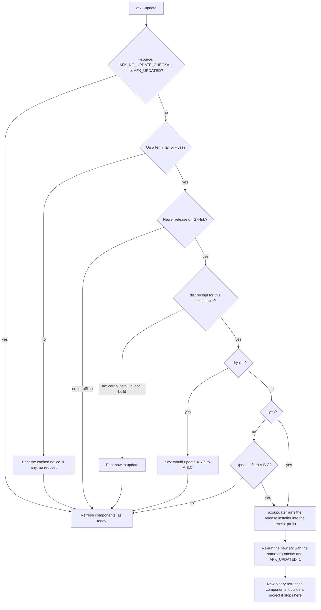

# Plan: afk updates itself (`afk --update`)

**Status.** Ready (approved 2026-11-11). Decisions: [ADR 0022](../adr/0022-afk-updates-itself.md) (Accepted).

## Source

- Described by the maintainer in chat, 2026-11-11. No GitHub issue: `gh issue list --state all` on DNRN/agentic-field-kit returns none.

## Summary

Updating afk is easy to forget. The user has to see that a new release exists and then rerun the install script. afk should say in its UI when a newer version is available, and `afk --update` should install it.

## Type

Enhancement. `afk --update` already exists and refreshes components (`installer/src/main.rs:32-34`, `:287-288`). This plan extends it to the binary, and adds a version check, which is new.

## Benefits

- Users find out about a release the next time they open `afk` or run `--list`, not by visiting GitHub. Today the maintainer's own machine runs 0.4.0 (`afk --version`) while 0.5.0 has been the latest release since 2026-11-10.
- One command replaces two: README *Updating* currently says to reinstall with the script and then run `afk --update` in each project (README.md:87, ADR 0010).

## Design

- **Check** (menu and `--list` header): this happens only on a terminal, without `--source`, and without `AFK_NO_UPDATE_CHECK=1`. It reads a cache file with the latest version and a timestamp, in the user's cache folder, next to the receipt's app name. If the cache is older than 24 hours, afk first records the attempt (with the last version seen), then a background thread queries the latest release (via axoupdater, with a short timeout) and rewrites the cache with the answer. So a query that fails, or that is still running when afk exits, still counts as the day's check, and an unreachable GitHub is asked once a day, not on every run. The menu draws at once and adds the notice when the result arrives. `--list` waits for the result up to 2 s. All errors are silent. Offline, afk shows what the last successful check found, or nothing if it has never checked.
- **Notice**: in the menu header next to `Agentic Field Kit {version}` and on the start screens, both through `title_line` (`installer/src/tui.rs`): `· A.B.C available · afk --update`. In `--list`, a second header line: `afk A.B.C is available: run afk --update` (`installer/src/list.rs`).
- **`--update` outside a project**: today it exits with "no project" (`installer/src/main.rs:383-396`). The binary step now runs first. After an update afk says to run `afk --update` in each project and exits 0; without one, the "no project" exit is unchanged.

## Impact

- CLI: `--update` doc comment (`installer/src/main.rs:32-34`), command dispatch (`:285-301`), the "no project" exit (`:383-396`), and `run` (`:96-153`). `run` applies component changes without asking when not on a terminal; the binary step does not follow it there and is skipped without `--yes` (round 2).
- TUI: header (`tui.rs:1037-1072`) and `title_line` (`tui.rs:899-905`). The `u` key marks *component* updates (README.md:67) and stays unrelated.
- `--list`: header line (`installer/src/list.rs:38`, `:47`). The notice only appears on a terminal, so piped output and `tests/install.test.sh` are unchanged.
- Version: `Source::version()` (`installer/src/source.rs:67-73`) is the current version. With `--source` there is no check.
- Receipt: written by the dist shell installer unless `AGENTIC_FIELD_KIT_DISABLE_UPDATE=1`. `install-updater = false` (`dist-workspace.toml:20`) only skips dist's separate updater binary. Present on this machine (written by 0.4.0). axoupdater only updates when the running executable is the one the receipt describes (`is_update_needed` → `check_receipt_is_for_this_executable`, axoupdater 0.10.3 `lib.rs:337`).
- Dependencies: `axoupdater = "0.10"` in `installer/Cargo.toml`, plus its own `reqwest` (for a client with timeouts: 5 s per request for the check, 30 s for the update) and `tokio` (the runtime for its async API), named directly. Until now there was no network code.
- Tests: Rust unit tests in `installer/src/update.rs` for the cache (fresh, stale, a day's boundary, a future time, corrupt, missing, and a failed query that waits a day) and for the version comparison. The `--list` notice line has a unit test in `list.rs`, and the TUI notice a `TestBackend` test. `tests/install.test.sh` exports `AFK_NO_UPDATE_CHECK=1` and turns it off only for the runs that make no request, with a cache that saw 99.0.0: without a terminal, `--update` prints the cached notice and still refreshes; `--source` has no binary step; `--list` shows no notice.
- Release: dist's PR build must still build all five targets (aws-lc-sys on aarch64 musl).
- Docs: README *Install*, the command table (`--update` row, README.md:70), *Updating* (README.md:87), `AFK_NO_UPDATE_CHECK`, CHANGELOG `[Unreleased]`, and the Status line of ADR 0010 once ADR 0022 is accepted.

## Deprecations

| What | Where | Callers | Choice |
| --- | --- | --- | --- |
| "Install the new release the same way, then `afk --update`" | README.md:87, ADR 0010 Decision | Users, docs | Replaced by one `afk --update` (round 1). ADR 0010 gets a partial supersede through ADR 0022; the README text is rewritten |

## Risks and quirks

- **Binary size.** Spike on 2026-11-11 (stripped, thin LTO): axoupdater with `blocking` added 5.3 MB to a hello-world (0.3 → 5.6 MB). afk will go from 1.4 MB to about 6.7 MB, pulling in reqwest 0.13, tokio, image, rustls, and aws-lc-rs. ureq 3 with self-replace added 2.0 MB (rustls with ring). The size is accepted to keep the update code dist's own (round 2).
- **Cross builds.** aws-lc-sys is C code built for every target. dist's PR build shows a failure before any release.
- **Integrity.** The shell installer checks each archive against sha256 values embedded in the script (verified in the 0.5.0 `installer.sh`). The 0.5.0 `installer.ps1` has no checksum check, so on Windows integrity rests on HTTPS to GitHub, as it does for a first install today.
- **`cargo install` into the same folder.** `cargo install` and the dist installer both use `~/.cargo/bin`. With a receipt left over from an earlier dist install, axoupdater treats a cargo build as a dist install and replaces it with the release binary. That gives the same release, a different build. Accepted.
- **Re-exec.** Components must come from the new binary, so afk runs the new binary with the same arguments. `AFK_UPDATED=1` stops it from updating again. On Windows the old process waits for the child and passes its exit code on.
- **Bootstrap.** Users on 0.5.0 or older reinstall once by hand.

## Decisions

- One command: `afk --update` updates the binary, then refreshes components with the new binary. Outside a project it updates the binary only (round 1). [ADR 0022](../adr/0022-afk-updates-itself.md).
- Mechanism: the axoupdater crate with dist's install receipt (round 1). ADR 0022.
- Check: in the menu and the `--list` header, cached for 24 hours, in the background, silent offline, terminal only, opt-out with `AFK_NO_UPDATE_CHECK=1` (round 1). ADR 0022.
- Without a receipt: print the update command and never replace the binary (round 1). ADR 0022.
- Not on a terminal and without `--yes`: the binary step makes no network request and replaces nothing. When the cache already knows of a newer release, it prints one line (`afk A.B.C is available: run afk --update on a terminal, or add --yes`). Components refresh as today (round 2).
- Menu: the notice only, no key that updates (round 2).
- Tracker: GitHub issues via `gh`, recorded in `AGENTS.md` (round 1).

## Assumptions

- The latest-release query works against this repository's `installer/vX.Y.Z` tags. Partly checked: `axotag::parse_tag("installer/v0.5.0")` gives 0.5.0, and every release has the `agentic-field-kit-installer.*` assets that axoupdater filters on. A full `is_update_needed` run needs the binary at the receipt's path, so it is checked when implementing.

## Open questions

None.

## Acceptance criteria

Agreed at approval (2026-11-11). Checked on Linux on 2026-11-11 with a 0.4.9 build in a sandbox (its own `HOME`, `XDG_CONFIG_HOME` with a receipt, `XDG_CACHE_HOME`) against the real 0.5.0 release.

- [x] With a newer release published, the menu header and the `--list` header (on a terminal) show the new version and `afk --update`. Offline, the menu opens as fast as today and shows nothing. The menu showed `0.5.0 available · afk --update` after the background check, without a key press. It draws before the check answers. Offline (`HTTPS_PROXY` pointed at a closed port), `--list` returned in 0.02 s without the notice.
- [x] Within 24 hours of a check, no new network request is made. The second `--list` took 0.02 s and came from the cache; unit tests cover the boundary.
- [x] `afk --update` on a dist install replaces the binary with the latest release, then refreshes components with the new binary's components. `afk --version` shows the new version. Interactive `y` and `--yes` both installed 0.5.0 into the receipt prefix, and the new binary reported `doc-sync: up to date`.
- [x] `afk --update` outside a project updates the binary, then says there is no project, without failing the binary step. It exits 0 with "Run afk --update in each project to refresh its components."
- [x] `--dry-run` shows the binary step without downloading. `--yes` skips its confirmation.
- [x] `cargo install` and `--source` runs print how to update and replace nothing. A copy outside the receipt prefix printed the `cargo install` command, and `--source` skips the step.
- [x] Not on a terminal and without `--yes`, `afk --update` makes no network request and doesn't replace the binary. Components refresh as today. It printed the cached notice only.
- [ ] `tests/run.sh`, `cargo test`, clippy, and CI pass on Linux, macOS, and Windows with no network access in tests. dist's PR build succeeds for all five targets. Linux passes locally; CI and dist's PR build run on the pull request.

## Implementation steps

1. `installer/src/update.rs`: receipt check, latest-version query, cache (read, write, staleness), and the binary update via axoupdater. Pure functions are unit-tested; network calls sit behind one function. Files: `installer/Cargo.toml`, `installer/src/lib.rs`.
2. Check in the background: start it in `main` for the menu and `--list`. Pass the result to `tui::App` (a channel the event loop polls) and to `list::table`. Files: `main.rs`, `tui.rs`, `list.rs`.
3. Notice: `header` and `title_line` in `tui.rs`, and the header in `list.rs`, with a `TestBackend` test.
4. `--update`: binary step before the component plan, the confirm, `--dry-run`/`--yes`, the non-terminal skip, re-exec with `AFK_UPDATED=1`, the outside-a-project path, and the no-receipt message. File: `main.rs`.
5. Tests: `tests/install.test.sh` sets `AFK_NO_UPDATE_CHECK=1`; CI runs it through `tests/run.sh`. Unit tests as in *Impact*.
6. Docs: README (*Install*, command table, *Updating*, `AFK_NO_UPDATE_CHECK`) and CHANGELOG `[Unreleased]` (Added). ADR 0010's Status already records the supersede.
7. Validate: `cargo fmt --all --check`, `cargo clippy --all-targets -- -D warnings`, `cargo test`, `tests/run.sh`, the dist PR build, and a manual run. For the manual run, build the new code as 0.4.9 into a sandbox receipt's prefix, then run `afk --update` against the real latest release.

## Refinement log

| Round | Question | Answer |
| --- | --- | --- |
| 1 | Tracker | GitHub issues via `gh`; recorded in `AGENTS.md` |
| 1 | What `afk --update` does | Binary first, then components with the new binary; outside a project, binary only |
| 1 | Update mechanism | axoupdater crate with dist's install receipt |
| 1 | When and where to check | Menu and `--list` header, cached 24 hours, background, silent offline, terminal only, opt-out |
| 1 | Installs without a receipt | Print the update command; never replace the binary |
| 2 | ADR 0022 | Accepted; ADR 0010's Status records the partial supersede |
| 2 | axoupdater's +5.3 MB (spike) vs ureq's +2.0 MB | Keep axoupdater |
| 2 | `--update` not on a terminal, without `--yes` | Skip the binary step and print a note; components as today |
| 2 | Menu key for the binary update | Notice only |
